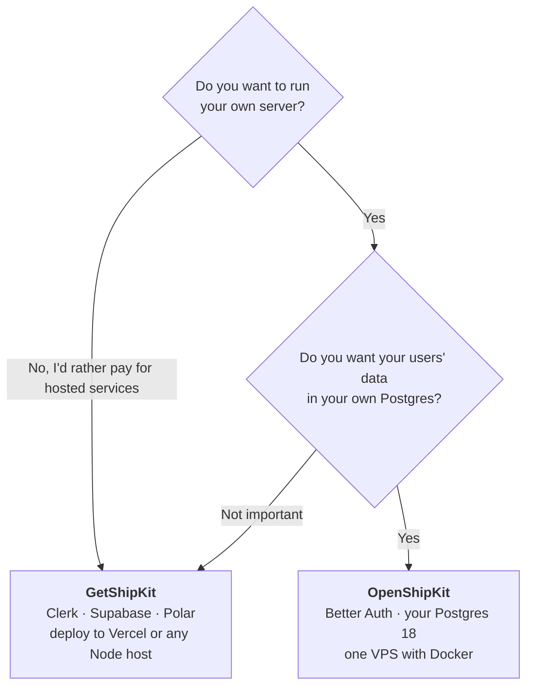
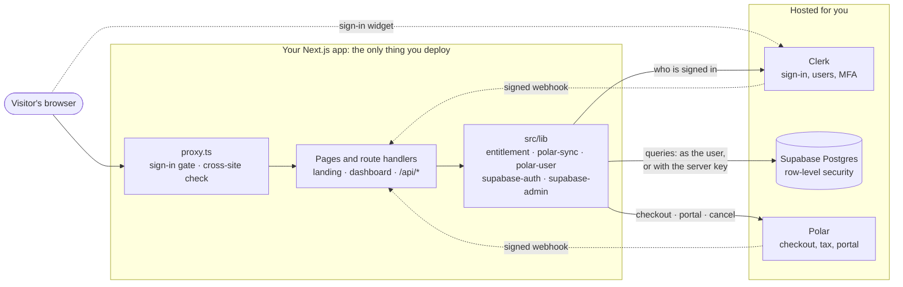
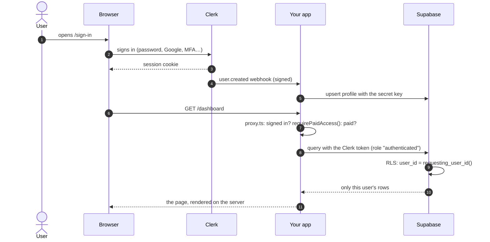
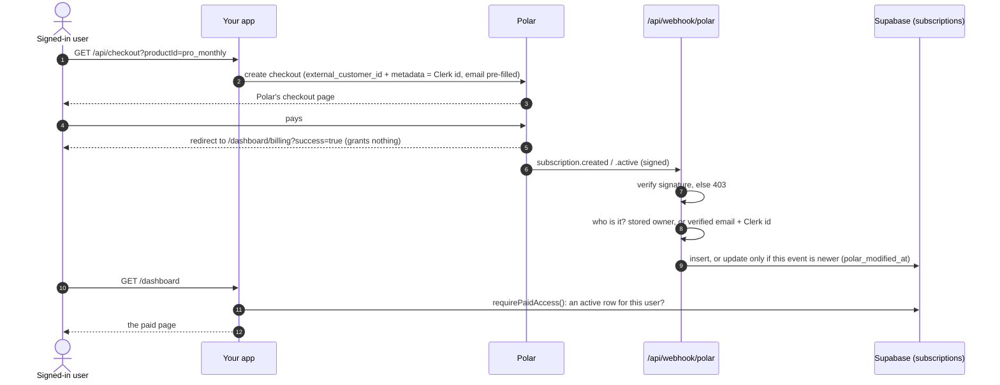
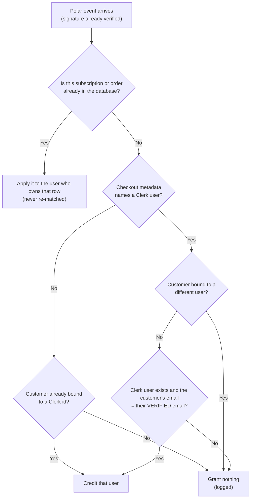
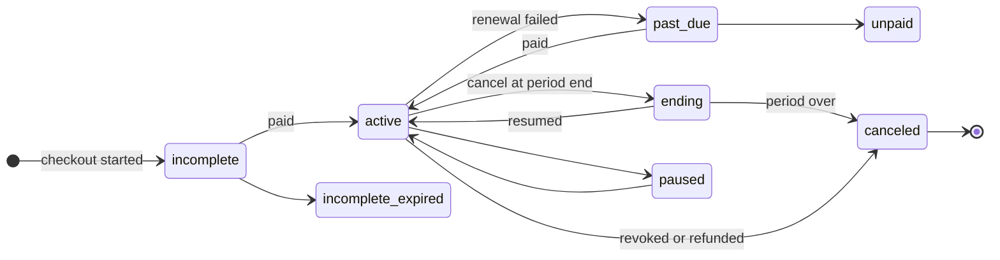
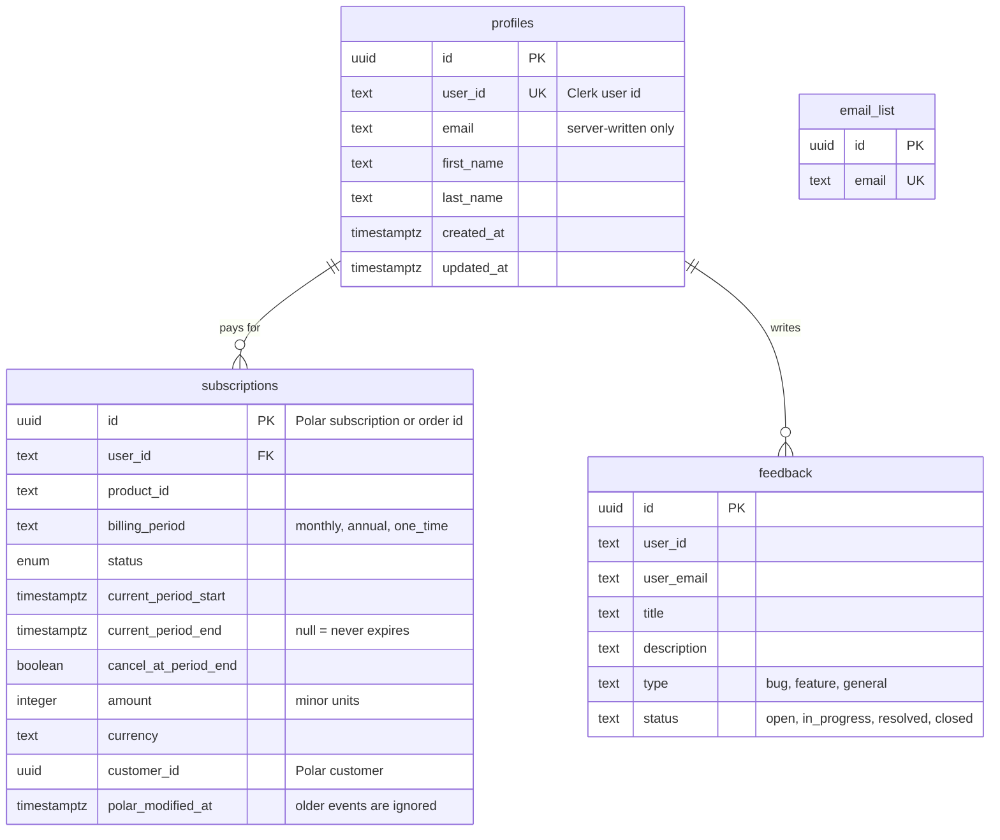
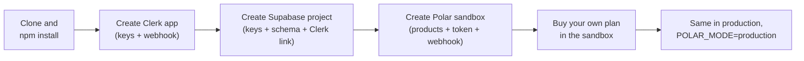
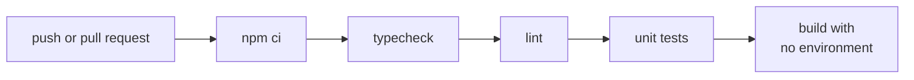

# GetShipKit

**A SaaS starter built on hosted services.** Landing page, sign-in, dashboard, subscriptions and
one-time purchases, wired together on Clerk, Supabase and Polar, with the parts that handle money
and data already right.

Next.js 16 · React 19 · TypeScript 6 · Tailwind CSS 4 · Clerk 7 · Supabase · Polar · Node.js 24 · MIT

[On DRISH LABS](https://drishlabs.com/apps/getshipkit) · [Changelog](CHANGELOG.md) · [Security](SECURITY.md) · [Design notes](DESIGN.md)

> [!CAUTION]
> **Security fix, 3 November 2026. If you deployed GetShipKit before this date, read
> [Security advisory: November 2026](#-security-advisory-november-2026) and run
> [`supabase/migrations/20261103000000_security_lockdown.sql`](supabase/migrations/20261103000000_security_lockdown.sql) now.**
> Anyone with your site's public Supabase key could list every user's email and subscription.

```bash
git clone https://github.com/DrisH31/GetShipKit.git my-saas
cd my-saas && npm install && npm run dev      # builds and runs before you have any keys
```

<a href="https://pages.razorpay.com/drishlabs"></a>

## Contents

1. [Security advisory: November 2026](#-security-advisory-november-2026)
2. [GetShipKit at a glance](#getshipkit-at-a-glance)
3. [GetShipKit or OpenShipKit?](#getshipkit-or-openshipkit)
4. [How it fits together](#how-it-fits-together)
5. [What happens when someone signs in](#what-happens-when-someone-signs-in)
6. [How a payment becomes access](#how-a-payment-becomes-access)
7. [The data model](#the-data-model)
8. [Who can read and write what](#who-can-read-and-write-what)
9. [Quick start](#quick-start)
10. [Setup, service by service](#setup-service-by-service)
11. [Every environment variable](#every-environment-variable)
12. [Make it yours](#make-it-yours)
13. [Project structure](#project-structure)
14. [Scripts, tests and CI](#scripts-tests-and-ci)
15. [Deploying](#deploying)
16. [Upgrading from 1.x](#upgrading-from-1x)
17. [Troubleshooting](#troubleshooting)
18. [What GetShipKit doesn't do (yet)](#what-getshipkit-doesnt-do-yet)
19. [Back this project](#back-this-project)
20. [License](#license)

## 🔒 Security advisory: November 2026

**What happened.** `schema_export.sql` created two `SECURITY DEFINER` database functions,
`debug_find_user_by_email` and `find_user_subscriptions_by_email`, and never revoked
PostgreSQL's default `EXECUTE` grant. On Supabase the `anon` role can call such functions,
and the anon key ships in every site's JavaScript. So anyone could call
`supabase.rpc('debug_find_user_by_email', { email_to_find: 'a' })` and get back users'
emails and Clerk user ids, and call the second function for subscription details and names.
Separately, any signed-in user could read every profile, and anyone could read the newsletter list.
It was reported responsibly by an independent security researcher.

**Fix it.**
1. Open your Supabase project, go to **SQL Editor**, paste in
   [`supabase/migrations/20261103000000_security_lockdown.sql`](supabase/migrations/20261103000000_security_lockdown.sql),
   and run it. It is safe to run more than once.
2. Read the result table it returns. Any row other than `OK` is something **you** added: a
   function, view, table or policy that a visitor, or **any signed-up account**, can reach.
   Anyone can create an account, so decide whether a stranger should reach it.
3. Run **Database → Advisors → Security Advisor** in Supabase and clear what it reports.
   An `OK` row **and** a clean Security Advisor mean you are done.
4. Update your app code from this repository (see [Upgrading from 1.x](#upgrading-from-1x)).
   Payments are now tied to the signed-in account instead of a partial email match.

From now on, functions you create are **not** callable by visitors unless you grant it:
`GRANT EXECUTE ON FUNCTION my_fn() TO authenticated;`. Grant only functions that answer for the
caller alone, and never a `SECURITY DEFINER` function that takes a user id or an email.

**Was I affected?**
- **Look for calls.** In Supabase, open **Logs → API** (or the Logs Explorer) and search for
  requests to `/rest/v1/rpc/debug_find_user_by_email` and
  `/rest/v1/rpc/find_user_subscriptions_by_email`. Your app never calls either, so any hit
  came from someone else. Note the dates and IP addresses. Log retention depends on your
  Supabase plan, so absence of a hit is not proof.
- **Treat it as a possible data breach.** If you find calls, or can't rule them out, user
  emails and names may have been exposed. Depending on where you and your users are
  (for example GDPR in the EU/UK), you may have to notify your data-protection authority
  (often within 72 hours of becoming aware) and your users. Take advice if unsure.
- **Check who was credited for payments.** The old Polar webhook matched payers to accounts by
  a partial email match and could credit the wrong account. Compare each row in
  `subscriptions` with the customer in your Polar dashboard, and fix any `user_id` that is wrong.
- `update_subscription_status` was also callable by anyone, but a bug made every call fail
  before it changed anything, so it could not have been used to alter subscriptions.


## GetShipKit at a glance

| | |
|---|---|
| **What it is** | A Next.js app you clone and turn into your own SaaS: marketing page, sign-in, a dashboard, billing and a paywall, already connected. |
| **Who it's for** | A developer who wants to charge for a web product soon and would rather pay a few services than run a server and a database. |
| **What you run** | Only the Next.js app. Sign-in (Clerk), the database (Supabase) and payments (Polar) are hosted for you. |
| **What it costs** | The code is free (MIT). The services charge their own prices: Clerk and Supabase have free tiers, and Polar takes a fee per sale. |
| **What's already right** | Access comes only from Polar (its signed webhook, or a server-side read of its API), never from the checkout redirect; paid pages are checked on the server; each user reads only their own rows; database functions are closed to visitors. |

**What you get**

- **A landing page** on the house design system (the same one OpenShipKit uses), light and dark,
  every word in one file and every section in the first byte of HTML.
- **Sign-in** with Clerk: sign-up, social logins, two-factor and the user menu.
- **A database** on Supabase Postgres, with row-level security keyed to the Clerk user.
- **Payments** with Polar: monthly, annual and one-time plans, checkout, a customer portal, cancel,
  and access that comes only from Polar: its signed webhook, or a server-side read of its API.
- **A dashboard**: billing, feedback, and paid pages checked on the server.
- **The basics done**: Terms and Privacy outlines, a newsletter, `/api/health`, a sitemap and
  `robots.txt`, unit tests and CI.

## GetShipKit or OpenShipKit?

Two starters from the same author, for opposite choices.
**[OpenShipKit](https://github.com/DrisH31/OpenShipKit)** is the sibling you run entirely on your
own server. They share no code and the same design language.



| | **GetShipKit** | **OpenShipKit** |
|---|---|---|
| **The idea** | Rent the hard parts: hosted auth and a hosted database | Own everything: one app on your own server |
| **Auth** | Clerk (hosted) | Better Auth inside the app; users in your Postgres |
| **Database** | Supabase (hosted Postgres) | Your own Postgres 18 (embedded Postgres in development) |
| **Payments** | Polar | Polar (optional) |
| **Email** | Sign-in emails sent by Clerk | Resend (needed at launch: sign-up verification and password resets) |
| **Where it runs** | Vercel or any Node.js host | Your VPS: Docker Compose + Caddy, Dokploy or Coolify |
| **To run it locally** | Clerk and Supabase accounts and keys first | Nothing: no accounts, no env, `npm run dev` |
| **Who holds user data** | Clerk, Supabase and Polar | You (and Polar, for billing, if payments are on) |
| **You look after** | Three services' keys, dashboards and plans | The server: updates, backups, restores |
| **Included** | Landing page, dashboard, billing, feedback, newsletter, legal page outlines, tests and CI | The same, plus blog, admin, media library, MCP server for AI agents, audit log, backups |
| **Pick it if** | You'd rather not run a server or a database | You want your users' data and your costs in your own hands |

## How it fits together

Your app is the only thing you deploy. Each hosted service sits behind one small module in the
code, so swapping or upgrading one touches one place.



| Layer | Lives in | Talks to | Rule |
|---|---|---|---|
| Proxy | `src/proxy.ts` | Clerk | An optimistic gate. Every page and route checks again for itself. |
| Pages | `src/app/**/page.tsx` | `src/lib`, components | Paid pages call `requirePaidAccess()` before reading anything paid. |
| Route handlers | `src/app/api/**/route.ts`, `src/app/portal` | `src/lib` | Each checks `auth()` or a webhook signature itself. |
| Server modules | `src/lib/*.ts` | Clerk, Supabase, Polar | The only place the service SDKs are called. |
| Config | `src/config/*.ts` | — | Words, plans, links and legal outlines: what you edit to make it yours. |
| Design system | `src/styles`, `src/components/{ui,marketing}` | — | Tokens and parts shared with OpenShipKit; your accent is `brand.css`. |

## What happens when someone signs in

Clerk handles the sign-in. Supabase trusts Clerk's session token (its third-party auth
integration), so every query a signed-in user makes runs **as that user**, and row-level security
decides what they see.



- The `user.created` / `user.updated` webhooks keep `profiles` in step with Clerk. `/api/auth/sync-user`
  covers the case where the webhook hasn't arrived yet.
- Users can **read** their own profile but never write it: profiles are written only by the server,
  so nobody can change the email that payments are matched against.
- `user.deleted` first ends the person's Polar subscriptions, then deletes their rows.

## How a payment becomes access

The redirect after checkout grants nothing. **Only Polar can grant access**: its signed webhook, or
a server-side read of Polar's API when the user presses "sync" (`/api/subscription/sync`). Either way
it lands on the provable buyer, and a late event can't undo a newer one.



**Who a purchase belongs to.** A purchase seen for the first time is credited only when it is
provably this user's. A buyer can type any email at Polar's checkout, so the email check matters.



**How Polar's status becomes access.** The webhook stores Polar's state; `requirePaidAccess()`
reads it. A status the code doesn't know grants nothing.



| Stored status | From Polar | Gives access? |
|---|---|---|
| `active` | `active` | Yes |
| `trial` | `trialing` | Yes |
| `ending` | `active` or `trialing` with cancel at period end | Yes, until the period ends |
| `past_due` | `past_due` | Yes (grace period) |
| `canceled` | `canceled`, a revoke, or a full refund of a one-time order | No |
| `unpaid`, `paused`, `incomplete`, `incomplete_expired` | the same | No |
| `pending` | a status this code doesn't know yet | No |

One-time purchases are granted on `order.paid` (not `order.created`, which fires before payment)
with no end date, and removed on a full refund.

## The data model



`schema_export.sql` creates all of this for a new project. Existing projects run the files in
[`supabase/migrations/`](supabase/migrations) instead, oldest first.

## Who can read and write what

Three roles reach the database: **anon** (anyone with the public key, i.e. every visitor),
**authenticated** (any signed-in user; anyone can sign up) and **service_role** (your server only,
with the secret key).

| Table or object | anon (visitors) | authenticated (signed-in users) | service_role (your server) |
|---|---|---|---|
| `profiles` | — | read **own** row | everything |
| `subscriptions` | — | read **own** rows | everything (the webhook writes here) |
| `feedback` | — | read own, insert own | everything |
| `email_list` | — | — | everything (via `/api/newsletter`) |
| `my_subscription_status` view | — | own row (runs as the caller) | — |
| `requesting_user_id()` | call (returns null) | call (returns own id) | call |
| `has_active_subscription_for_auth()` | — | call (own status only) | call |
| Any function **you** add later | — | — | call |

Functions you create start with no visitor access: grant `EXECUTE` only to functions that answer for
the caller alone, and never a `SECURITY DEFINER` function that takes a user id or an email.

## Quick start

Needs **Node.js 24** or newer.

```bash
git clone https://github.com/DrisH31/GetShipKit.git my-saas
cd my-saas
npm install
cp .env.example .env.local     # fill it in: see Setup below
npm run dev                    # http://localhost:3000
```

`npm run build` succeeds with no environment variables, so CI can check the code before any keys
exist. A build you **deploy** needs the `NEXT_PUBLIC_*` values set at build time: Next.js writes them
into the browser JavaScript then.



## Setup, service by service

You need free accounts at Clerk, Supabase and Polar. Every value goes in `.env.local`;
[`.env.example`](.env.example) lists them all.

### 1. Clerk

1. Create an application at [dashboard.clerk.com](https://dashboard.clerk.com) and copy
   `NEXT_PUBLIC_CLERK_PUBLISHABLE_KEY` and `CLERK_SECRET_KEY`.
2. **Webhooks** → add an endpoint `https://YOUR_DOMAIN/api/webhook/clerk` for `user.created`,
   `user.updated` and `user.deleted`. Copy its signing secret into `CLERK_WEBHOOK_SIGNING_SECRET`.

### 2. Supabase

1. Create a project at [supabase.com](https://supabase.com/dashboard). From **Project Settings →
   API Keys** copy the URL, the publishable key (`sb_publishable_…`) and the secret key
   (`sb_secret_…`). The legacy anon / service_role keys also work.
2. **SQL Editor**: paste and run [`schema_export.sql`](schema_export.sql). It creates the tables,
   turns on row-level security, and makes sure database functions are not callable by visitors.
3. **Connect Clerk**: in Clerk open [Setup → Supabase](https://dashboard.clerk.com/setup/supabase)
   and activate the integration (this adds the `role: authenticated` claim). Then in Supabase,
   **Authentication → Sign In / Providers → Third-Party Auth → Add provider → Clerk**, and paste
   your Clerk domain.
4. Run **Database → Advisors → Security Advisor** and make sure it is clean.

### 3. Polar

Start in the **sandbox** ([sandbox.polar.sh](https://sandbox.polar.sh)): a separate organisation
with its own token, products and webhook secret.

1. Create your products. Copy their ids into `NEXT_PUBLIC_PRODUCTS` as `"id:Display name"`, and set
   the same prices in `src/config/plans.ts`.
2. Create an organisation access token: `POLAR_ACCESS_TOKEN`. Set `POLAR_MODE=sandbox`.
3. **Settings → Webhooks** → add `https://YOUR_DOMAIN/api/webhook/polar` with **API version
   2026-10** (pinned in `src/lib/polar.ts`), subscribed to the `subscription.*`, `order.paid` and
   `order.refunded` events. Copy the secret into `POLAR_WEBHOOK_SECRET`.
4. For local development, expose port 3000 with a tunnel (for example `ngrok http 3000`) and use
   that URL for both webhooks.

**Sandbox checklist, before real money**

| Do this | You should see |
|---|---|
| Subscribe monthly | The dashboard shows the plan, active |
| Cancel | "Ending", with an end date |
| Resubscribe | Active again |
| Buy the one-time plan | Lifetime access, no end date |
| Refund it in Polar | Access removed |
| Redeliver an old webhook from Polar's dashboard | Nothing changes |

## Every environment variable

| Variable | Required | Public? | Read by | What it's for |
|---|---|---|---|---|
| `NEXT_PUBLIC_SITE_URL` | in production | yes | `app/layout.tsx`, `lib/same-site.ts`, sitemap | Your origin: metadata, the sitemap and the cross-site request check |
| `NEXT_PUBLIC_CLERK_PUBLISHABLE_KEY` | yes | yes | Clerk SDK | Clerk in the browser |
| `CLERK_SECRET_KEY` | yes | **secret** | Clerk SDK | Clerk on the server |
| `NEXT_PUBLIC_CLERK_SIGN_IN_URL`, `…_SIGN_UP_URL` | no | yes | Clerk SDK | Where the sign-in and sign-up pages are |
| `NEXT_PUBLIC_CLERK_SIGN_IN_FALLBACK_REDIRECT_URL`, `…_SIGN_UP_…` | no | yes | Clerk SDK | Where to go after signing in or up |
| `CLERK_WEBHOOK_SIGNING_SECRET` | yes | **secret** | `api/webhook/clerk` | Verifies Clerk's webhooks (`CLERK_WEBHOOK_SECRET` also read) |
| `NEXT_PUBLIC_SUPABASE_URL` | yes | yes | `lib/supabase-env.ts` | Your Supabase project |
| `NEXT_PUBLIC_SUPABASE_PUBLISHABLE_KEY` | yes | yes | `lib/supabase-env.ts` | Browser and signed-in queries (`…_ANON_KEY` also read) |
| `SUPABASE_SECRET_KEY` | yes | **secret** | `lib/supabase-admin.ts` | Server writes; bypasses RLS (`SUPABASE_SERVICE_ROLE_KEY` also read) |
| `POLAR_MODE` | no | no | `lib/polar.ts` | `sandbox` (default) or `production` |
| `POLAR_ACCESS_TOKEN` | to sell | **secret** | `lib/polar.ts`, `portal` | Checkout, portal, cancel, revoke |
| `POLAR_WEBHOOK_SECRET` | to sell | **secret** | `api/webhook/polar` | Verifies Polar's webhooks |
| `POLAR_SUCCESS_URL` | no | no | `api/checkout` | Where Polar sends buyers back |
| `NEXT_PUBLIC_PAYMENT_MODEL` | no | yes | `utils/paymentModel.ts` | `subscription` (default) or `onetime` |
| `NEXT_PUBLIC_PRODUCTS` | to sell | yes | `config/productIds.ts` | Your Polar product ids and names |
| `PAID_REPOSITORY_URL`, `PAID_QUICK_START_URL`, `PAID_DOCS_URL`, `SOCIAL_URL`, `WEBSITE_URL` | no | no | `config/paid-content.ts` | What paying customers see on `/dashboard` (server-only) |

## Make it yours

| What | Where |
|---|---|
| Every word on the landing page | `src/config/content.ts` |
| Plans, prices and features (keep prices equal to Polar's) | `src/config/plans.ts` |
| Your name, repository and links (empty links are hidden) | `src/config/site.ts` |
| Terms and Privacy (outlines until you write them; set `ready: true` after) | `src/config/legal.ts` |
| What paying customers see on `/dashboard` | `src/config/paid-content.ts` or the `PAID_*` variables |
| The accent colour, in both schemes | `src/styles/brand.css` |
| Why the page is built the way it is | `DESIGN.md` |

Renaming the site in `src/config/site.ts` also hides everything that talks about GetShipKit itself
(the clone command, the OpenShipKit comparison) and turns the footer into "Built with GetShipKit".

**Adding a paid page**

```tsx
// src/app/dashboard/reports/page.tsx
import { requirePaidAccess } from "@/lib/entitlement";

export const dynamic = "force-dynamic";

export default async function ReportsPage() {
  const userId = await requirePaidAccess(); // not signed in → /sign-in, not paid → /dashboard/billing
  return <Reports userId={userId} />;
}
```

In a route handler, call `hasPaidAccess(userId)` and answer 403 when it's false. Never gate paid
content in a client component: anything sent to the browser before a server check is given away.

## Project structure

```
src/
├── app/
│   ├── page.tsx                 landing page (sections in components/landing/)
│   ├── sign-in/, sign-up/       Clerk pages
│   ├── legal/[slug]/            Terms and Privacy
│   ├── dashboard/               signed-in area (billing, feedback; paid pages checked on the server)
│   ├── portal/route.ts          Polar customer portal
│   └── api/
│       ├── checkout/            start a Polar checkout
│       ├── webhook/polar/       Polar → subscriptions (grants access)
│       ├── webhook/clerk/       Clerk → profiles
│       ├── subscription/        read, cancel, sync the user's subscription
│       ├── auth/sync-user/      make sure the user has a profile row
│       ├── newsletter/          newsletter sign-up
│       └── health/              200 when the database answers, 503 when not
├── components/
│   ├── landing/                 the landing page's sections
│   ├── site/                    header, footer, logo, newsletter form
│   ├── marketing/               layout, type and FAQ parts (design system)
│   ├── pricing/                 the plan cards (landing and billing)
│   └── ui/                      button and other primitives (design system)
├── config/                      content, plans, site links, legal outlines
├── lib/
│   ├── entitlement.ts           requireUser() / requirePaidAccess(): the paywall
│   ├── polar.ts                 Polar client (API version pinned here)
│   ├── polar-sync.ts            writes Polar state into the database
│   ├── polar-user.ts            which user a payment belongs to
│   ├── supabase-admin.ts        server-only client (secret key, bypasses RLS)
│   └── supabase-auth.ts         server client acting as the signed-in user
├── styles/                      the design system's tokens, theme and motion; brand.css is yours
└── proxy.ts                     first-pass route protection and the cross-site request check
tests/                           unit tests for the money and security paths
schema_export.sql                full database schema for a new project
supabase/migrations/             changes for existing projects, oldest first
```

## Scripts, tests and CI

| Script | What it does |
|---|---|
| `npm run dev` | The app with hot reload, on port 3000 |
| `npm run build` | A production build, then the sitemap and `robots.txt` |
| `npm start` | Serve the production build |
| `npm run typecheck` | TypeScript, no output |
| `npm run lint` | ESLint (Next.js rules) |
| `npm test` | The unit tests (Vitest) |
| `npm run check` | typecheck, lint and test, in that order |

**What the tests cover** (48 tests)

| File | Tests | Proves |
|---|---|---|
| `tests/polar-user.test.ts` | 9 | A purchase is credited only to the provable buyer; typed-in emails, unverified emails and deleted users get nothing |
| `tests/polar-status.test.ts` | 12 | Every Polar status maps to the right access; unknown statuses grant nothing |
| `tests/safe-redirect.test.ts` | 15 | `?redirect=` can never send someone to another site |
| `tests/same-site.test.ts` | 10 | Cross-site API requests are refused, behind proxies too |
| `tests/utils.test.ts` | 2 | The type scale and colours merge correctly |



[`.github/workflows/ci.yml`](.github/workflows/ci.yml) runs that on every push.

## Deploying

GetShipKit is a standard Next.js app: Vercel, any Node.js host, or `npm run build && npm start`.

1. Set every variable from `.env.example` in your host **before building**, including
   `NEXT_PUBLIC_SITE_URL` with your real origin. Behind a reverse proxy that rewrites `Host`, set
   `NEXT_PUBLIC_SITE_URL` or pass `X-Forwarded-Host`, or API calls from your own pages are refused.
2. Point the Clerk and Polar webhooks at your production URL.
3. Point an uptime monitor at `/api/health`.
4. Publish your own security contact at `/.well-known/security.txt`.

## Upgrading from 1.x

2.0 moves to Next.js 16, React 19.3, Tailwind CSS 4, Clerk 7, Supabase's new API keys and the Polar
SDK 1.0, rewrites the payment webhook and redesigns the landing page.

1. Run the files in [`supabase/migrations/`](supabase/migrations) in the Supabase SQL Editor,
   oldest first.
2. Rename env vars (the old names still work): `NEXT_PUBLIC_SUPABASE_ANON_KEY` →
   `NEXT_PUBLIC_SUPABASE_PUBLISHABLE_KEY`, `SUPABASE_SERVICE_ROLE_KEY` → `SUPABASE_SECRET_KEY`,
   `CLERK_WEBHOOK_SECRET` → `CLERK_WEBHOOK_SIGNING_SECRET`.
3. Set your Polar webhook endpoint's API version to **2026-10**, and add `order.paid` and
   `order.refunded` to its events.
4. Use Node.js 24.
5. Subscriptions created before 2.0 carry no Clerk id at Polar. The webhook keeps them with the
   user already stored on their row, so they keep working.
6. One-time purchases made with 1.x are stored under a random id, not Polar's order id, so a refund
   in Polar will **not** remove that access automatically. Remove it by hand if you refund one.
7. `SubscriptionGuard` is gone (it only ran in the browser). Call `requirePaidAccess()` at the top of
   each paid page instead.
8. Landing copy moved into `src/config/content.ts`, and plans into `src/config/plans.ts`.

## Troubleshooting

| Symptom | Likely cause | Fix |
|---|---|---|
| Signed in, but the dashboard shows no data or "permission denied" | The Clerk ↔ Supabase link is missing | Setup → Supabase step 3 |
| Paid, but no access | A wrong `POLAR_WEBHOOK_SECRET` (Polar shows 403s), or the email at Polar differs from the verified Clerk email | Check Polar → Webhooks → deliveries; fix the email in Polar and redeliver |
| `[polar] … no matching user` in the log | A purchase made outside the app's checkout, or the emails differ | As above |
| Clerk webhook fails | Wrong `CLERK_WEBHOOK_SIGNING_SECRET`, or the URL isn't public | Copy the secret again; use your public URL or a tunnel |
| API calls answer "Cross-site request refused" | A proxy rewrote `Host` | Set `NEXT_PUBLIC_SITE_URL` to your real origin |
| `/api/health` answers 503 | The app can't reach Supabase | Check `NEXT_PUBLIC_SUPABASE_URL` and `SUPABASE_SECRET_KEY` |
| A deployed page fails in the browser | `NEXT_PUBLIC_*` values were missing at build time | Set them, then rebuild |

## What GetShipKit doesn't do (yet)

Honest limits, so you know what you'd add:

| Not included | What that means for you |
|---|---|
| More than one language | Every word is English; there's no locale switch |
| Teams and organisations | Accounts are single people: no organisations, seats, roles or SSO |
| Payment providers other than Polar | Stripe or Razorpay means rewriting checkout and the webhook |
| A blog, an admin panel, email of its own | Clerk sends sign-in mail; OpenShipKit has the rest |
| Error tracking | Read your host's logs, or add a service |
| A Content Security Policy header | Add one carefully: Clerk needs its domains allowed |
| A rate limit on the newsletter | Sign-ups are validated, but nothing slows a flood |

## Back this project

GetShipKit is free and MIT licensed, built and maintained by one developer. If it saved
you time, you can back the work: ₹79, ₹199, ₹999 or an amount of your own, on a Razorpay
page that takes UPI, netbanking and cards, Indian or international (charged in rupees).
Paying unlocks nothing: everything is already in the repo.

<a href="https://pages.razorpay.com/drishlabs"></a>

## License

**MIT**: free for any use, commercial or personal. Build and sell products with it, use it at
work or for clients, change it, and keep your changes private. The only condition is keeping the
copyright notice in [LICENSE.md](LICENSE.md). It comes with no warranty.
